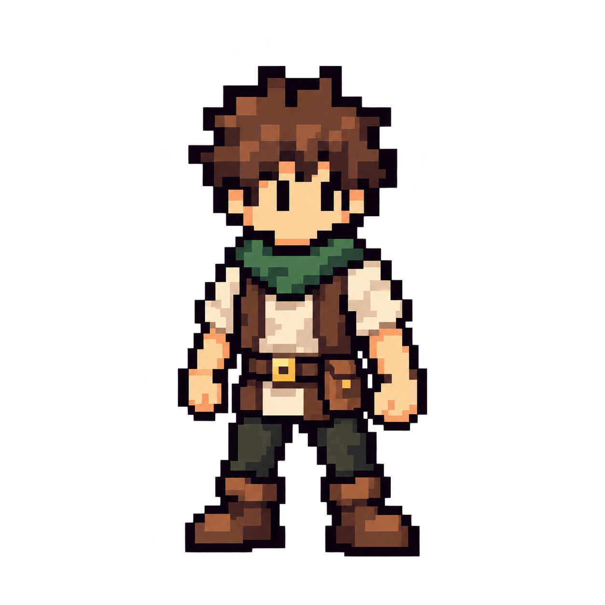

<p align="center">
  
</p>

<h1 align="center">Commitkin</h1>

<p align="center">Your GitHub activity. Your evolving pixel character.</p>

<p align="center">
  <a href="docs/installation.md"><strong>Get started</strong></a> ·
  <a href="https://github.com/JEONTAK#user-content-commitkin">Live example</a> ·
  <a href="#how-it-works">How it works</a> ·
  <a href="#credits">Credits</a>
</p>

---

Turn public contributions into a pixel character on your GitHub profile.

**25 classes · 12 traits · 36 achievement tiers**

- **Grow** — earn XP, unlock classes and upgrade your look.
- **Show** — one character image, six Markdown stat bars and a recent-activity summary.
- **Own** — settings and growth stay in your fork. Your profile receives only the display.
- **Run** — GitHub Actions and the built-in token. No server, signup or PAT.

> **Pre-release · Public activity only · Manual runs**<br>
> Other-user installation, live recovery and artwork rights review remain open.

## Choose your faction

| 🌿 Bloomguard | 🔥 Ashbound |
| :---: | :---: |
| Cozy fantasy guild | Dark fantasy order |

Your first saved faction is permanent.

## Installation

You need a personal GitHub.com account and two public repositories:

| Repository | Purpose |
| --- | --- |
| `YOUR_LOGIN/commitkin` | Your actual fork: settings, growth and character |
| `YOUR_LOGIN/YOUR_LOGIN` | Your profile: README display |

1. Fork [JEONTAK/commitkin](https://github.com/JEONTAK/commitkin).
2. Preview a faction, then explicitly save your character.
3. Add these markers to your profile README **once**:

```md
<!-- COMMITKIN:START -->
<!-- COMMITKIN:END -->
```

4. Install profile sync, preview it, then publish when ready.

**[Copyable workflows and step-by-step setup →](docs/installation.md)**

Private activity is not included. Both workflows are manual; updating your fork does not automatically update your profile. You never paste the generated stats yourself.

### Installation troubleshooting

A preview saves nothing. A missing or pending snapshot cannot publish a profile. Keep your records and [check the reported reason](docs/installation.md#troubleshooting).

## How it works

Public commits, merged PRs, reviews, docs, tests, releases and issue operations shape your character.

- **Classes:** previous 90 completed UTC days.
- **Traits and recent activity:** previous 30 completed UTC days.
- **XP:** up to 100 per original activity date.
- **Appearance:** upgrades every five levels through 50 for regular classes. Adventurer keeps its starter look until a class is assigned.

Scores describe observed contribution style, not skill or account-wide productivity. Discovery is best-effort; missing required data pauses growth instead of counting as inactivity.

[Rules and analysis limits](packages/commitkin/README.md) · [Repository settings](docs/installation.md#repository-settings)

## Recovery

Do not delete records, mix snapshots or reselect a faction to retry. Restore the five matching files from one valid same-owner fork snapshot. Uninstalling does not erase your saved growth.

[Recovery and uninstall guide](docs/installation.md#recovery)

## Development

[Runtime and local tests](packages/commitkin/README.md) · [Validation evidence](docs/product/github-character/local-mvp-implementation.md) · [Commit identity migration](docs/commit-identity-migration.md)

## Credits

Code, docs and workflows: [MIT](LICENSE) © 2026 JEONTAK. Dependencies retain their licenses.

Character art has [separate provenance](packages/commitkin/assets/characters/README.md) and is not covered by MIT. Only the Bloomguard Adventurer original is integrated; other artwork uses development fallbacks. The full art set and rights clearance remain pending. User profiles and growth data are not licensed under the code license.
